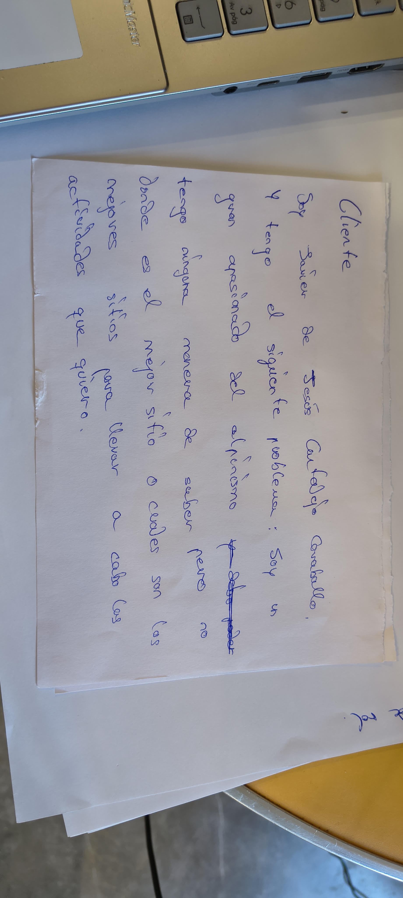
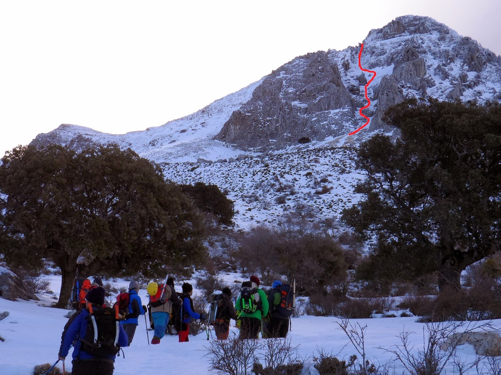
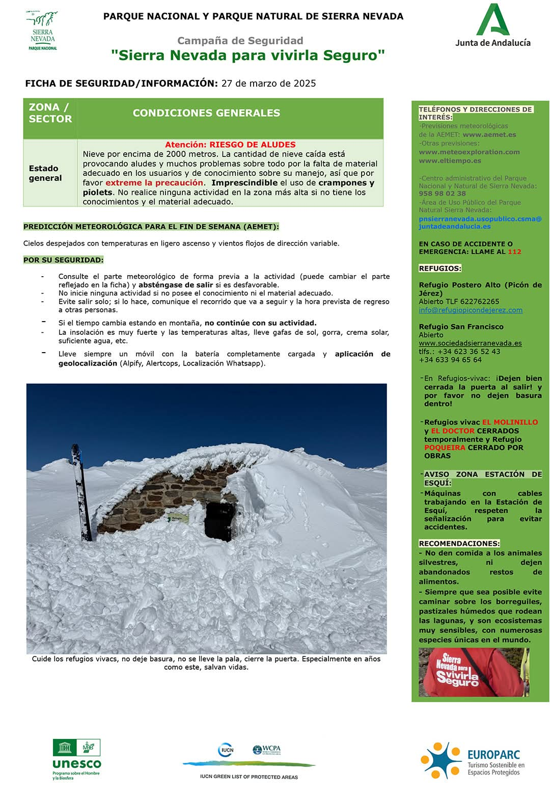

# AlpinismoHoy
Exposición del problema existente en relación a la falta de información detallada sobre las condiciones naturales en montaña, concretamente en la provincia de Jaén, en Sierra Magina, en Peña Jaén.

## Problema a resolver

Uno de los entornos naturales españoles en los que mas deporte se práctica es la montaña, contamos con numerosos lugares en los que se pueden realizar diferentes deportes, aunque en este caso nos centraremos en el _Alpinismo_ entendido como subir a una montaña utilizando tecnicas de progresión en condiciones de elevada altitud. Estas técnicas engloban la escalada en roca, escalada en hielo, manejo de piolet (Bastón de hierro que se usa para anclarse a un terreno helado), uso de crampones (Botas con puntas para andar por terreno helado), uso de casco y material para resistencia al frio adecuado, el uso o no de las técnicas y materiales citados depende de las condiciones de la ruta en la que nos encontramos.

Cuando uno va a realizar una actividad de alpinismo en un entorno natural debe ser consciente de que no tenemos control sobre las condiciones externas y actuar en consecuencia. Por ello, es de vital importancia tener una previsión de las condiciones para poder elegir cuando se va a realizar la ruta, por donde exactamente y con que equipamiento, de modo que podamos maximizar nuestra propia seguridad. En la mayoria de macizos de España tenemos una previsión detallada tanto a nivel meteorológico como del estado del manto de nieve en caso de que lo haya. Sin embargo, y aqui comienza el problema, en Jaén se carece de tal información, por lo que se complica considerablemente planear una ruta.

El problema concreto se da en el "canuto de peña Jaén", una escarpada pendiente de hielo y roca que se usa para acceder a la montaña homónima. Como ya he mencionado, se carece de un boletín de información detallado que permita conocer las condiciones del momento de la ruta, concretamente, la temperatura que va a hacer junto con la sensación termica, el estado del cielo(cubierto, semicubierto, soleado,lloviendo, nevando, tormenta o granizando), cuanta nieve hay y el estado de dicha nieve ( nieves que se mantienen muy heladas debido a condiciones de mucho frio conllevan el uso de material especifico, mientras que nieves mas blandas alomejor nos obligan a escoger otro itinerario o a usar otro equipo, como raquetas). Para planear una ruta, esto tiene graves ceonsecuencias, puedes llegar al lugar y encontrarte que no hay nieve, que te pille una tormenta, que haya mas nieve de la esperada o que esta este helada, que haga demasiado calor para el equipamiento que se está usando o lo contrario, que haga demasiado frio, cualquiera de estas posibilidad daría lugar a no poder realizar la actividad en condiciones seguras.

El boletín que se precisaría sería algo parecido a lo siguiente:

## ¿Por que me implica personalmente?
Soy y siempre he sido un gran aficionado a todo tipo de deportes de montaña y siempre los he prácticado habiendome topado con el problema que el cliente describe a cerca de ellos en numerosas ocasiones e implicandome por tanto personalmente en la resolución del mismo.

## ¿Cómo se obtienen los datos?
Para la obtención de los datos, trataremos de construir una representación del estado de la montaña a partir de los datos meteorológicos actuales y pasados obtenidos periodicamente de estaciones cercanas a la montaña, cobertura de nieve, historico de precipitación y reportes humanos.

He reunido las siguientes fuentes:

- [AEMET](docs/datosEjemplo.txt) -> Mediante la API _OpenData_ de _AEMET_ se pueden obtener datos meteorológicos de los muicipios mas cercanos y estaciones de manera periódica, estos son los datos de Torres, el municipio que más nos interesa.

- [Copernicus](https://land.copernicus.eu/en/products/snow/snow-cover-extent-europe-v1-0-500m) -> [Fotografía](media/sierra_nevada_26_06.png) de alta resolución por satelite de Copernicus de la capa de nieve y [API estadística.](https://documentation.dataspace.copernicus.eu/APIs/SentinelHub/Statistical.html)

- [IGN / CING](https://centrodedescargas.cnig.es/CentroDescargas/buscar-mapa) -> Para obtener mapa con elevada resolución de la zona.

- [Junta de Andalucía](https://www.juntadeandalucia.es/medioambiente/portal/web/ventanadelvisitante/detalle-buscador-mapa/-/asset_publisher/Jlbxh2qB3NwR/content/subida-a-pico-m%C3%A1gina-y-miramundos) -> Aqui se obtiene una versión en GML de las posibles rutas.

- [Wikiloc](https://es.wikiloc.com/rutas-senderismo/mata-bejid-torres-18668294) -> Scrapping para en caso de haber rutas recientes, obtener información adicional de rutas realizadas por personas.

## ¿Donde está la logica de negocio?
Se plantea realizar una ficha de seguridad especifica para Peña Jaén, que detalle a partir de los datos obtenidos de estaciones cercanas, las temperaturas y condiciones esperadas. Se realizarian calculos a partir de los datos de temperatura y humedad para obtener las condiciones de temperatura y humedad arriba en la montaña, y se añadirá la última foto disponible de satelite junto con una descripción del posible estado de la nieve en base a las condiciones de los últimos dias y una recomendación de otro dia de la semana que tenga mejores condiciones de esa semana. De manera adicional, en caso de existir, se añadiran reportes recientes de personas reales que hicieron la ruta.

## Doccumentos de interes

- [user journey](docs/user_journey.md)
- [personas](docs/personas.md)
- [milestones](docs/milestones.md)
- [user stories](docs/user_stories.md)

## Configuración adicional
Puede verse en detalle la configuración adicional de este proyecto en: [Ver detalles de configuración](configuracion.md)
